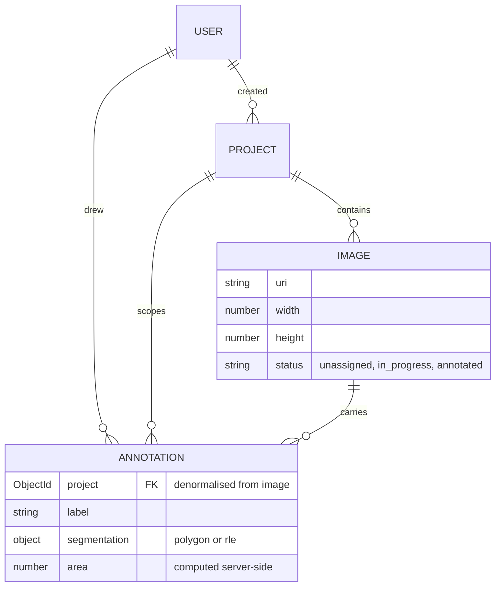
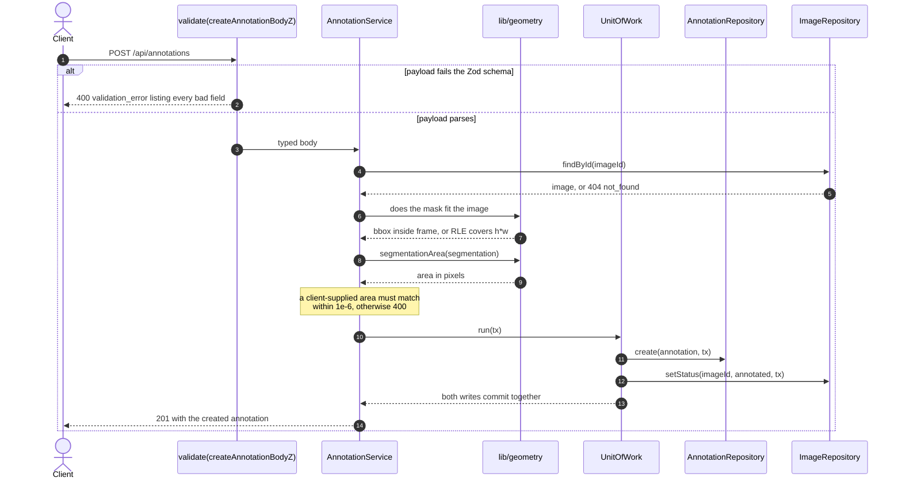

# PearlAI API

A REST API for running image-segmentation annotation projects: upload images,
let annotators draw masks on them as polygons or RLE, and get back the counts a
project lead asks for — how many images, how many masks, who drew them, where a
mask ranks by size on its image.

The part worth reading is the validation. A segmentation payload that does not
agree with the image it claims to cover is rejected before it reaches the
database, and the `area` on every stored annotation is the one the server
computed, never the one the client sent.

```bash
curl -X POST http://localhost:7151/api/annotations \
  -H 'Content-Type: application/json' \
  -d '{"image":"d2d9dc3250fdd3885ddc99ad","label":"car",
       "segmentation":{"type":"polygon","polygons":[
         {"rings":[[[100,100],[300,100],[300,250],[100,250]]]}]}}'
```

```json
{ "id": "32f9f161460e0b96c0b6c4df", "label": "car", "area": 30000 }
```

`area` was computed from the rings, and the project was derived from the image.

## Five minutes to a running API

No database required — `PERSISTENCE=memory` runs every repository in-process.

```bash
npm install
PERSISTENCE=memory npm run dev     # -> PearlAI API listening on 7151
curl http://localhost:7151/api/health
```

`.postman/PearlAI.API.postman_collection.json` is generated from the live
Express router by `npm run postman:generate`, which fails if a registered route
has no request in it, so it cannot silently drift. Its 27 requests cover all 18
routes, each asserting the status this README documents.

## What lives in the database

`Annotation.project` is denormalised from the image so project-scoped queries
and the export endpoint never need a join; the service derives it from the image
and refuses a request that supplies a conflicting one.



Every list filter is paired with its sort key in a compound index, so MongoDB
satisfies the sort from the index instead of buffering matches and sorting in
memory; `{ image: 1, area: -1 }` is what makes the rank endpoint a counted index
scan. Indexes live in `src/models/`, field semantics and payload examples in
[`MODEL.md`](MODEL.md).

## How a mask becomes an annotation



| Rule                                        | Applies to | Failure message contains              |
| ------------------------------------------- | ---------- | ------------------------------------- |
| 3+ points per ring, 1+ ring per polygon     | polygon    | schema `validation_error`             |
| Bounding box inside the image frame         | polygon    | `falls outside`                       |
| `size` equals `[image.height, image.width]` | RLE        | `must equal image dimensions`         |
| `counts` sums to exactly `height * width`   | RLE        | `must cover exactly N pixels`         |
| Computed area above zero                    | both       | `Segmentation encloses no area`       |
| Supplied `area` matches the computed one    | both       | `does not match server-computed area` |

## Suggesting a label

`POST /api/annotations/suggest-label` takes an unsaved mask and ranks the labels
already used in that project, returning `{ provider, suggestions }` where each
suggestion carries a `label`, a `confidence` and a `reason`.

The default provider does **not** recognise objects and does not pretend to. It
answers a narrower question an annotation tool wants pre-filled: _which labels
in this project have been applied to masks shaped like this one?_ It extracts
four scale-invariant features — area as a fraction of the image, bounding-box
aspect ratio, how solidly that box is filled, ring count — and takes a
similarity-weighted vote over the project's recent annotations. No network, no
key, no randomness: identical input gives an identical ranking, which is why the
tests assert on it.

`LABEL_SUGGESTER=anthropic` swaps in a provider backed by the Claude Messages
API. Its output is constrained to the project's vocabulary, and every failure
path falls back to the heuristic, so enabling it cannot turn a working endpoint
into a 500. Both implement `LabelSuggester` in `src/ai/types.ts`.

## The endpoints

Base URL `http://localhost:7151/api`.

| Method | Path                                       | Notes                                             |
| ------ | ------------------------------------------ | ------------------------------------------------- |
| `GET`  | `/health` `/health/live` `/health/ready`   | `ready` returns **503** when a dependency is down |
| `POST` | `/auth/signup` `/auth/login`               | `{ user, token, expiresIn }`. Rate limited        |
| `POST` | `/projects`                                | Create a project                                  |
| `GET`  | `/projects`                                | Paged list, newest first. `?status=`              |
| `GET`  | `/projects/:id`                            | One project                                       |
| `GET`  | `/projects/:id/stats`                      | Counts plus a per-annotator breakdown             |
| `GET`  | `/projects/:id/annotations/export`         | Flat export, one bounding box per mask            |
| `POST` | `/projects/:projectId/images`              | Bulk add, all-or-nothing                          |
| `GET`  | `/projects/:projectId/images`              | Paged list. `?status=`                            |
| `GET`  | `/images/:id`                              | One image                                         |
| `POST` | `/annotations`                             | Create from polygon or RLE                        |
| `POST` | `/annotations/suggest-label`               | Rank labels for an unsaved mask                   |
| `GET`  | `/annotations`                             | `?label=` `?imageId=` `?projectId=` `?createdBy=` |
| `GET`  | `/annotations/:id` `/annotations/:id/rank` | One annotation; rank by area within its image     |

List endpoints take `?page=` and `?limit=` and return
`{ page, limit, total, items }`. `limit` caps at 100, `page` at 10000 — offset
pagination degrades badly at high skip values, so the API refuses rather than
running a slow query. `annotator` is an alias for `createdBy`.

## Errors

Every failure has the same body, with a stable `code`, a human `message`, an
optional `details` array and the `requestId` the access log also carries.

Codes: `validation_error`/`bad_request` (400), `unauthorized` (401),
`forbidden` (403), `not_found` (404), `conflict` (409), `payload_too_large`
(413), `rate_limited` (429), `service_unavailable` (503), `internal_error`
(500). A 500 returns the literal `Internal Server Error` under
`NODE_ENV=production`; the real text is logged, not sent.

## Swapping the storage

Services depend on the interfaces in `src/domain/ports.ts`, never on Mongoose.

```
src/domain/ports.ts          4 repository interfaces + UnitOfWork
src/repositories/mongo/      Mongoose adapter; the only Document -> domain mapping
src/repositories/memory/     in-process Maps
src/container.ts             picks one and wires every service
```

Above that line everything deals in the plain records from
`src/domain/models.ts`: `id` is a string, dates are `Date`, no `_id`, `__v` or
`ObjectId` appears in any response — a test asserts that. Two things fall out of
the seam: the API runs with no database, and the HTTP suite drives the real
Express stack over in-memory maps, needing neither a container nor a network.

## Running against MongoDB

```bash
cp .env.example .env    # set MONGODB_URI
npm run dev             # or: docker compose up --build
curl http://localhost:7151/api/health/ready
```

Compose brings up `mongo:7` and the API. Mongo's port publishes to
`127.0.0.1:7152` only, so the database is not reachable from the host's network.
The image is a three-stage build (compile, production-only dependencies,
runtime); the final stage runs as the `node` user with a `HEALTHCHECK` polling
`/api/health/ready`.

> `docker compose config` parses this file. The image build and container boot
> were **not** run — Docker was unavailable on the machine this was written on.
> The build steps are ordinary `npm ci` and `tsc`, both verified natively.

## Configuration

Every variable, with defaults and comments, is in
[`.env.example`](.env.example), and `src/config/env.ts` parses and validates the
lot at startup — a bad value aborts the process with a message naming the field.
Conditionally required: `MONGODB_URI` when `PERSISTENCE=mongo`, `JWT_SECRET`
(min 16 chars) when `AUTH_REQUIRED` is on, `ANTHROPIC_API_KEY` when
`LABEL_SUGGESTER=anthropic`.

`AUTH_REQUIRED` gates the writes — create project, bulk add images, create
annotation, suggest label — and leaves reads open. It accepts `true/false`,
`1/0`, `yes/no`, `on/off` and rejects anything else, so no value is ever coerced
into meaning its opposite. `tests/unit/env.test.ts` pins that.

## Tests, lint, types

```bash
npm test          # 171 tests in 10 files, no database, no network
npm run lint      # eslint 9 flat config + typescript-eslint
npm run typecheck # tsc --noEmit, strict
```

Last green run: **171 passed, 0 failed**, about 2.5 seconds. `tests/unit/`
covers geometry, env parsing and both label suggesters. `tests/api/` drives
supertest against the real app: routing, validation, pagination, auth under both
`AUTH_REQUIRED` settings, token expiry and forgery, every documented error
status, and the transaction boundary that flips an image to `annotated`.

## What this does not do

- **No update or delete.** Annotations and projects are append-only: no
  `PATCH /annotations/:id`, no archive endpoint despite `archived` existing on
  the model, no way to reassign an image.
- **Offset pagination only**, with a hard page ceiling rather than a cursor.
  `GET /annotations` with no filter is capped but still a `createdAt` scan.
- **The rate limiter is in-process**, so behind more than one instance each gets
  its own counter.
- **No refresh tokens.** Access tokens live 12 hours; that is the whole story.
