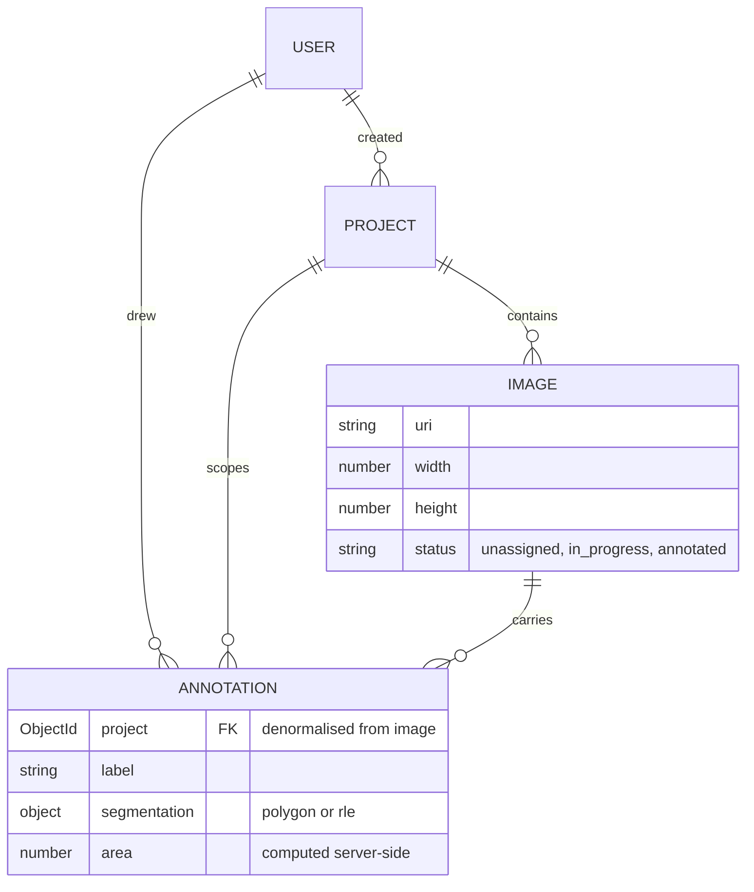
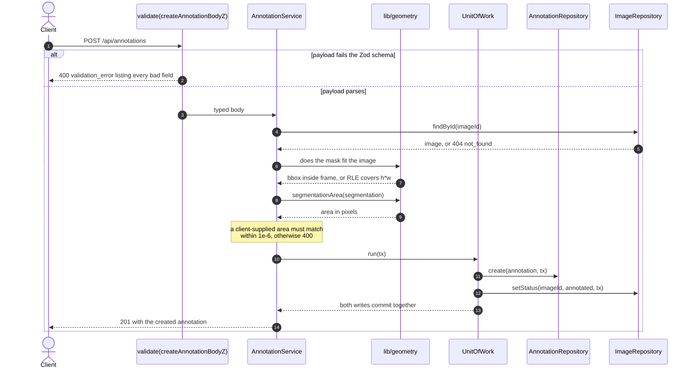

# Segmentation Annotation API

A REST API for running image-segmentation annotation projects: register
images, let annotators submit masks as polygons or COCO-style RLE, and get back
the numbers a project lead asks for: how many images, how many masks, who drew
them, where a mask ranks by size on its image. The package is `pearlai-api` and
the service calls itself "PearlAI API" in its logs and health output.

The part worth reading is the validation. A segmentation that does not agree
with the image it claims to cover is rejected before it reaches the database,
and the `area` on every stored annotation is the one the server computed, never
the one the client sent.

```bash
curl -X POST http://localhost:7151/api/annotations \
  -H 'Content-Type: application/json' \
  -d '{"image":"6af06127c3575d6558f921e4","label":"car",
       "segmentation":{"type":"polygon","polygons":[
         {"rings":[[[100,100],[300,100],[300,250],[100,250]]]}]}}'
```

```json
{
  "id": "6af06127c3575d6558f921e8",
  "projectId": "6af06127c3575d6558f921de",
  "imageId": "6af06127c3575d6558f921e4",
  "label": "car",
  "segmentation": {
    "type": "polygon",
    "polygons": [
      {
        "rings": [
          [
            [100, 100],
            [300, 100],
            [300, 250],
            [100, 250]
          ]
        ]
      }
    ]
  },
  "area": 30000,
  "createdBy": "6af06127c3575d6558f921dc",
  "createdAt": "2026-11-08T11:46:47.847Z",
  "updatedAt": "2026-11-08T11:46:47.847Z"
}
```

`area` was computed from the ring, `projectId` was derived from the image, and
`createdBy` came from the bearer token. The examples in this README were
captured from the Compose stack (MongoDB 7), so the ids are real ObjectIds.

## Running it

Requires Docker, or Node 22 (`.nvmrc`) for the local path.

**With Docker Compose**, which runs the API against MongoDB:

```bash
printf 'JWT_SECRET=%s\n' "$(openssl rand -hex 32)" > .env
docker compose up --build -d --wait
curl http://localhost:7151/api/health/ready
# {"status":"ready","dependencies":[{"name":"mongodb","state":"up","detail":"connected"}]}
```

Compose only reads `.env` to fill in the `${...}` values in
`docker-compose.yml`; persistence and the Mongo URI are fixed there. Without a
`JWT_SECRET` the API still starts, but `/api/auth/*` answers 503. Stop it with
`docker compose down` (add `-v` to drop the database volume).

**Without a database.** `PERSISTENCE=memory` runs every repository in-process,
and data is lost on restart:

```bash
npm ci
cp .env.example .env              # then set JWT_SECRET if you want /api/auth
PERSISTENCE=memory npm run dev    # -> PearlAI API listening on 7151
curl http://localhost:7151/api/health
```

Point `MONGODB_URI` in `.env` at a MongoDB instance and drop the
`PERSISTENCE=memory` prefix to run the local process against a real database.
Compose publishes Mongo on `127.0.0.1:7152`, so
`MONGODB_URI=mongodb://localhost:7152/pearlai` works alongside the stack.

**Postman.** `.postman/PearlAI.API.postman_collection.json` holds 27 requests
covering all 18 routes, chained through collection variables, and each one
asserts the status this README documents. `npm run postman:generate`
regenerates it from the live Express router and fails if a registered route has
no request, so it cannot silently drift. Against the Compose stack it runs clean
with newman:

```bash
npx newman run .postman/PearlAI.API.postman_collection.json \
  --env-var email=someone-new@example.com    # 27 requests, 27 assertions, 0 failed
```

## What lives in the database

`Annotation.project` is denormalised from the image so project-scoped queries
and the export endpoint never need a join; the service derives it from the image
and refuses a request that supplies a conflicting one.



Every list filter is paired with its sort key in a compound index, so MongoDB
satisfies the sort from the index instead of buffering matches and sorting in
memory; `{ image: 1, area: -1 }` is what makes the rank endpoint a counted index
scan. Indexes live in `src/models/`, field semantics and payload examples in
[`MODEL.md`](MODEL.md).

## How a mask becomes an annotation



| Rule                                        | Applies to | Failure message contains              |
| ------------------------------------------- | ---------- | ------------------------------------- |
| 3+ points per ring, 1+ ring per polygon     | polygon    | schema `validation_error`             |
| Bounding box inside the image frame         | polygon    | `falls outside`                       |
| `size` equals `[image.height, image.width]` | RLE        | `must equal image dimensions`         |
| `counts` sums to exactly `height * width`   | RLE        | `must cover exactly N pixels`         |
| Computed area above zero                    | both       | `Segmentation encloses no area`       |
| Supplied `area` matches the computed one    | both       | `does not match server-computed area` |

## A session against the API

Sign up, create a project, register images, annotate. Signup always creates an
`annotator`; a `role` in the body is ignored. Tokens are shortened here.

```bash
curl -X POST localhost:7151/api/auth/signup -H 'Content-Type: application/json' \
  -d '{"name":"Ada Lovelace","email":"ada@example.com","password":"correct-horse-battery"}'
# 201 {"user":{"id":"6af06127c3575d6558f921dc","name":"Ada Lovelace","email":"ada@example.com",
#      "role":"annotator",...},"token":"eyJhbG...","expiresIn":"12h"}

curl -X POST localhost:7151/api/projects -H "Authorization: Bearer $TOKEN" \
  -H 'Content-Type: application/json' -d '{"name":"Street scenes","description":"Dashcam frames"}'
# 201 {"id":"6af06127c3575d6558f921de","name":"Street scenes","status":"active",
#      "createdBy":"6af06127c3575d6558f921dc",...}

curl -X POST localhost:7151/api/projects/6af06127c3575d6558f921de/images \
  -H "Authorization: Bearer $TOKEN" -H 'Content-Type: application/json' \
  -d '{"images":[{"uri":"https://example.com/frame-001.jpg","width":1280,"height":720},
                 {"uri":"https://example.com/frame-002.jpg","width":1280,"height":720}]}'
# 201 {"inserted":2,"images":[{"id":"6af06127c3575d6558f921e4","status":"unassigned",...},...]}
```

An RLE mask on the same 1280x720 frame. `counts` alternates background and
foreground runs in column-major order and must sum to `720 * 1280`:

```bash
curl -X POST localhost:7151/api/annotations -H 'Content-Type: application/json' \
  -d '{"image":"6af06127c3575d6558f921e4","label":"road",
       "segmentation":{"type":"rle","size":[720,1280],"counts":[1000,2160,918440]}}'
# 201 {"id":"6af06127c3575d6558f921f0","label":"road","area":2160,...}
```

Three of the rejections from the table above, as the API returns them:

```json
{"error":{"code":"bad_request","message":"RLE counts sum to 922000 but the mask must cover exactly 921600 pixels","requestId":"c15ddf26-25e2-426c-ace8-63305f703c81"}}
{"error":{"code":"bad_request","message":"Client-supplied area 12345 does not match server-computed area 30000","requestId":"fff97898-ebb5-4e16-841f-e1ae2fa07f24"}}
{"error":{"code":"bad_request","message":"Polygon bounding box [1200, 600, 200, 100] falls outside the 1280x720 image","requestId":"c811fb1e-ae10-440d-ac18-0c704bf3b01b"}}
```

The read side, after a `car` (30000 px), a `sign` (1600 px, posted without a
token) and the `road` mask:

```bash
curl localhost:7151/api/projects/6af06127c3575d6558f921de/stats
# {"projectId":"6af06127c3575d6558f921de","images":2,"annotations":3,"perAnnotator":[
#   {"annotatorId":null,"count":2},
#   {"annotatorId":"6af06127c3575d6558f921dc","count":1,"name":"Ada Lovelace","email":"ada@example.com"}]}

curl localhost:7151/api/annotations/6af06127c3575d6558f921ec/rank
# {"annotationId":"6af06127c3575d6558f921ec","imageId":"6af06127c3575d6558f921e4",
#  "area":1600,"rank":3,"total":3}

curl localhost:7151/api/projects/6af06127c3575d6558f921de/annotations/export
# {"projectId":"6af06127c3575d6558f921de","truncated":false,"count":3,"annotations":[
#   {"label":"car","area":30000,"bbox":[100,100,200,150],...},
#   {"label":"sign","area":1600,"bbox":[600,40,40,40],...},
#   {"label":"road","area":2160,"bbox":[1,0,4,720],...}]}
```

`bbox` is `[x, y, width, height]`. The `road` run starts in column 1 and wraps
through column 4, which is why its box spans the full height.

## Suggesting a label

`POST /api/annotations/suggest-label` takes an unsaved mask and ranks the labels
already used in that project, returning `{ provider, suggestions }` where each
suggestion carries a `label`, a `confidence` and a `reason`.

The default provider does **not** recognise objects and does not pretend to. It
answers a narrower question an annotation tool wants pre-filled: _which labels
in this project have been applied to masks shaped like this one?_ It extracts
four scale-invariant features — area as a fraction of the image, bounding-box
aspect ratio, how solidly that box is filled, ring count — and takes a
similarity-weighted vote over the project's 200 most recent annotations, each
measured against the size of the image it was drawn on. No network, no key, no
randomness: identical input gives an identical ranking, which is why the tests
assert on it.

```bash
curl -X POST localhost:7151/api/annotations/suggest-label -H 'Content-Type: application/json' \
  -d '{"image":"6af06127c3575d6558f921e4","segmentation":{"type":"polygon","polygons":[
       {"rings":[[[700,300],[890,300],[890,440],[700,440]]]}]}}'
# {"provider":"heuristic","suggestions":[
#   {"label":"car","confidence":0.718,"reason":"shape resembles existing \"car\" annotations in this project"},
#   {"label":"sign","confidence":0.198,"reason":"shape resembles existing \"sign\" annotations in this project"},
#   {"label":"road","confidence":0.084,"reason":"shape resembles existing \"road\" annotations in this project"}]}
```

`LABEL_SUGGESTER=anthropic` swaps in a provider backed by the Claude Messages
API. Its output is constrained to the project's vocabulary, and every failure
path falls back to the heuristic, so enabling it cannot turn a working endpoint
into a 500. Both implement `LabelSuggester` in `src/ai/types.ts`.

## The endpoints

Base URL `http://localhost:7151/api`.

| Method | Path                                       | Notes                                             |
| ------ | ------------------------------------------ | ------------------------------------------------- |
| `GET`  | `/health` `/health/live` `/health/ready`   | `ready` returns **503** when a dependency is down |
| `POST` | `/auth/signup` `/auth/login`               | `{ user, token, expiresIn }`. Rate limited        |
| `POST` | `/projects`                                | Create a project                                  |
| `GET`  | `/projects`                                | Paged list, newest first. `?status=`              |
| `GET`  | `/projects/:id`                            | One project                                       |
| `GET`  | `/projects/:id/stats`                      | Counts plus a per-annotator breakdown             |
| `GET`  | `/projects/:id/annotations/export`         | Flat export, one bounding box per mask            |
| `POST` | `/projects/:projectId/images`              | Bulk add, all-or-nothing                          |
| `GET`  | `/projects/:projectId/images`              | Paged list. `?status=`                            |
| `GET`  | `/images/:id`                              | One image                                         |
| `POST` | `/annotations`                             | Create from polygon or RLE                        |
| `POST` | `/annotations/suggest-label`               | Rank labels for an unsaved mask                   |
| `GET`  | `/annotations`                             | `?label=` `?imageId=` `?projectId=` `?createdBy=` |
| `GET`  | `/annotations/:id` `/annotations/:id/rank` | One annotation; rank by area within its image     |

List endpoints take `?page=` and `?limit=` and return
`{ page, limit, total, items }`. `limit` caps at 100, `page` at 10000 — offset
pagination degrades badly at high skip values, so the API refuses rather than
running a slow query. `annotator` is an alias for `createdBy`.

## Errors

Every failure has the same body, with a stable `code`, a human `message`, an
optional `details` array and the `requestId` the access log also carries.

Codes: `validation_error`/`bad_request` (400), `unauthorized` (401),
`forbidden` (403), `not_found` (404), `conflict` (409), `payload_too_large`
(413), `rate_limited` (429), `service_unavailable` (503), `internal_error`
(500). A 500 returns the literal `Internal Server Error` under
`NODE_ENV=production`; the real text is logged, not sent.

## Swapping the storage

Services depend on the interfaces in `src/domain/ports.ts`, never on Mongoose.

```
src/domain/ports.ts          4 repository interfaces + UnitOfWork
src/repositories/mongo/      Mongoose adapter; the only Document -> domain mapping
src/repositories/memory/     in-process Maps
src/container.ts             picks one and wires every service
```

Above that line everything deals in the plain records from
`src/domain/models.ts`: `id` is a string, dates are `Date`, no `_id`, `__v` or
`ObjectId` appears in any response — a test asserts that. Two things fall out of
the seam: the API runs with no database, and the HTTP suite drives the real
Express stack over in-memory maps, needing neither a container nor a network.

## The container

The image is a three-stage build (compile, production-only dependencies,
runtime) on `node:22-alpine`; the final stage runs as the `node` user with a
`HEALTHCHECK` polling `/api/health/ready`. Compose waits for `mongo:7` to pass
its own health check before starting the API, and publishes Mongo's port to
`127.0.0.1:7152` only, so the database is not reachable from the host's
network.

Compose runs a standalone `mongod`, which cannot do multi-document
transactions. `MongoUnitOfWork` detects that on the first write and runs units
of work without a session from then on; against a replica set the same code
gets a real transaction.

## Configuration

Every variable, with defaults and comments, is in
[`.env.example`](.env.example), and `src/config/env.ts` parses and validates the
lot at startup. A bad value aborts the process with a message naming the field;
an empty one (`JWT_SECRET=`) counts as unset.
Conditionally required: `MONGODB_URI` when `PERSISTENCE=mongo`, `JWT_SECRET`
(min 16 chars) when `AUTH_REQUIRED` is on, `ANTHROPIC_API_KEY` when
`LABEL_SUGGESTER=anthropic`.

`AUTH_REQUIRED` gates the writes — create project, bulk add images, create
annotation, suggest label — and leaves reads open. It accepts `true/false`,
`1/0`, `yes/no`, `on/off` and rejects anything else, so no value is ever coerced
into meaning its opposite. `tests/unit/env.test.ts` pins that.

## Tests, lint, types

```bash
npm test          # 176 tests in 10 files, no database, no network
npm run lint      # eslint 10 flat config + typescript-eslint
npm run format:check
npm run typecheck # tsc --noEmit, strict
```

Last green run: **176 passed, 0 failed**, about 5 seconds in a container. `tests/unit/`
covers geometry, env parsing and both label suggesters. `tests/api/` drives
supertest against the real app: routing, validation, pagination, auth under both
`AUTH_REQUIRED` settings, token expiry and forgery, every documented error
status, and the transaction boundary that flips an image to `annotated`.

## What this does not do

- **No update or delete.** Annotations and projects are append-only: no
  `PATCH /annotations/:id`, no archive endpoint despite `archived` existing on
  the model, no way to reassign an image.
- **Offset pagination only**, with a hard page ceiling rather than a cursor.
  `GET /annotations` with no filter is capped but still a `createdAt` scan.
- **The rate limiter is in-process**, so behind more than one instance each gets
  its own counter.
- **No refresh tokens.** Access tokens live 12 hours; that is the whole story.
- **No roles in practice.** `admin` exists on the model, but signup only
  creates annotators and nothing checks the role yet.
- **`createdBy` is caller-supplied.** An explicit `createdBy` in a body
  overrides the token's user, so attribution is a convenience, not an audit
  trail.

## License

MIT, see [`LICENSE`](LICENSE).
